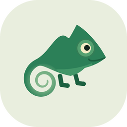
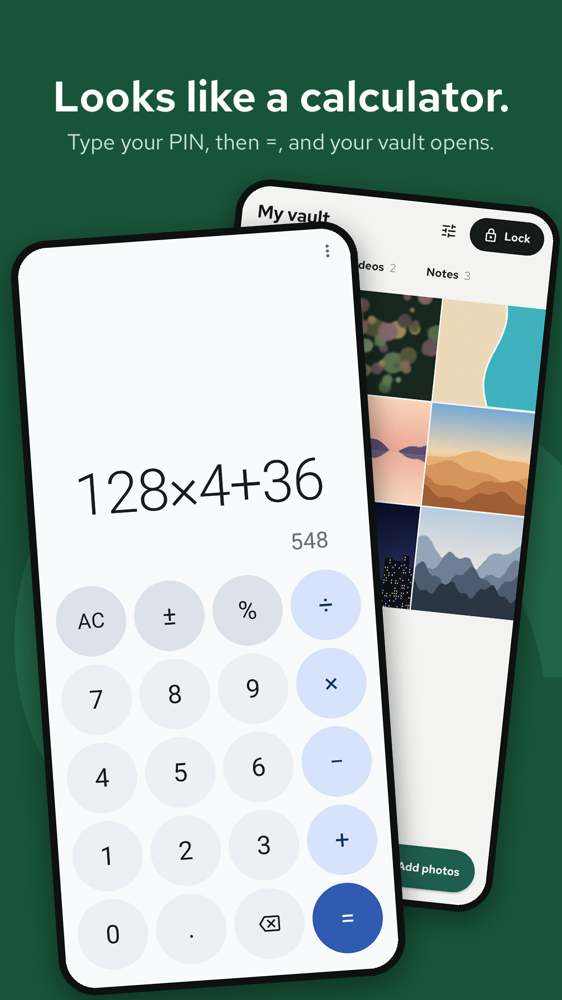
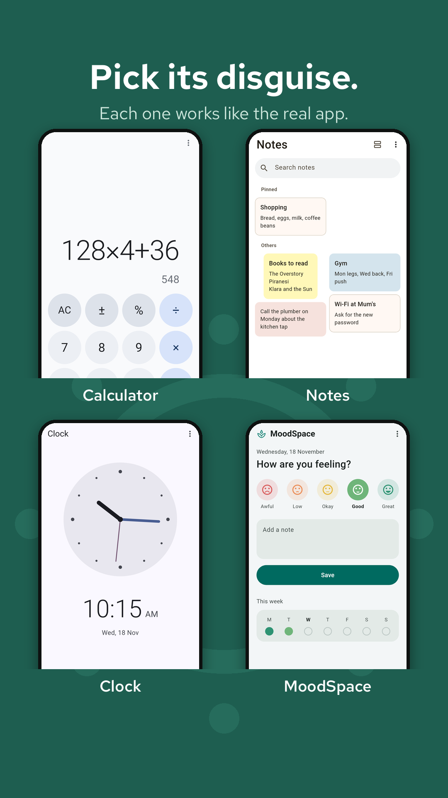
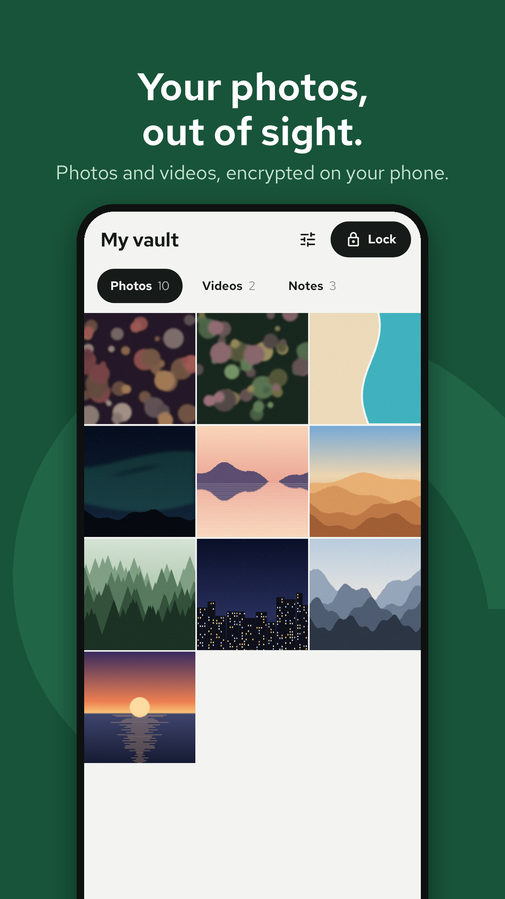

<p align="center">
  
</p>

SecureVault keeps photos, videos and notes in a private vault on your phone.
It takes the name and icon of a Calculator, Notes, Clock or MoodSpace app that really works, and your PIN opens the vault inside it.
Each vault has its own PIN, and everything in it is encrypted with a key made from that PIN.
Nothing leaves the phone unless you share it.
SecureVault is free, with no ads and no in-app purchases.

Get it on [Google Play](https://play.google.com/store/apps/details?id=com.shravangoswami.securevault), and read more at [chaosmos.studio/securevault](https://chaosmos.studio/securevault/).

## Screenshots

<p align="center">
  
  
  
</p>

## Build

SecureVault is built with Flutter 3.44.0.

```bash
flutter pub get
flutter run
flutter test
```

A debug build installs as `com.shravangoswami.securevault.dev`, beside the Play build.

## License

SecureVault is available under the [GNU General Public License, version 3 or later](LICENSE).
The Red Hat Text font is under the [SIL Open Font License](assets/fonts/RedHatText-OFL.txt).

## Credits

SecureVault was created by Shravan Goswami ([shravanngoswamii](https://github.com/shravanngoswamii)), Jash Ambaliya ([AJ0070](https://github.com/AJ0070)) and Jitendra Verma ([jitendravjh](https://github.com/jitendravjh)).
Chaosmos, the studio Shravan Goswami runs, publishes and maintains it.

## Privacy and terms

Read the [privacy policy](https://chaosmos.studio/securevault/privacy/) and the [terms of service](https://chaosmos.studio/securevault/terms/).
